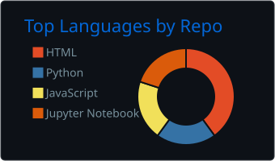
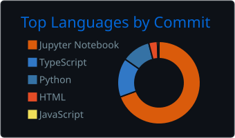
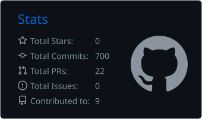

# Hi, I'm Musab 👋

Software Engineering student at **NUST SEECS** (Class of 2027), building myself towards **AI Engineering**.
I like making practical tools people actually use, from healthcare monitoring to education platforms for students in Pakistan.

- 🔭 Currently building **CVere**, an evidence-verifying multi-agent hiring system (Final Year Project)
- 🌱 Building **Humraah**, a higher-education guidance platform for girls in Pakistan
- ❤️ Working on **QALB**, an IoMT remote cardiac monitoring system
- 🛡️ Previously: Frontend Developer at **CodexCape** · Cybersecurity intern at **NUST Information Assurance Lab** (WAF configuration, threat detection)
- 📍 Rawalpindi / Islamabad, Pakistan

## 🚀 Featured projects

| Project | What it is | Stack |
|---|---|---|
| [**Humraah**](https://github.com/humraah-co/humraah-web) | Higher-education guidance for girls in Pakistan: what to study, where, and how to pay for it | Next.js · TypeScript · Tailwind · Supabase |
| [**QALB**](https://github.com/M-Musab-A-23/qalb) | IoMT cardiac monitoring: simulated ESP32 wearable streams ECG over MQTT, ML flags abnormal heartbeats | ESP32 · MQTT · Python · ML |
| [**Churn Prediction with GNNs**](https://github.com/M-Musab-A-23/Churn-Prediction-Through-GNN) | GraphSAGE / GAT + GraphSMOTE vs. classical baselines on the Telco churn dataset | PyTorch Geometric · scikit-learn · XGBoost |
| [**Chokidaar**](https://github.com/M-Musab-A-23/chokidaar) | AI-powered Web Application Firewall | Python · ML · Security |
| [**Afwaah**](https://github.com/Hassan-Shahid123/afwaah-campus-rumour-system) | Decentralised, anonymous campus rumour verification — NUST Olympiad Hackathon | React · Node.js |
| [**Life Dashboard**](https://github.com/Sohaib-Sarwar/Life-Dashboard) | Full-stack productivity & wellness platform (my role: frontend & UI) | React · Flask · JWT |
| [**Student Focus**](https://github.com/M-Musab-A-23/Student-Focus) | Task manager + Pomodoro focus timer for students | React · Vite |
| [**Chattu**](https://github.com/M-Musab-A-23/Chattu) | Peer-to-peer video calling, built for a competition | WebRTC · PeerJS · React |

## 🛠️ Tech stack

  
   
  

## 📊 GitHub stats

  
  
  

## 📫 Reach me

